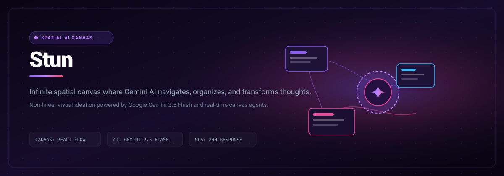

# Stun

> Infinite spatial canvas where Gemini AI navigates, organizes, and transforms thoughts in real time.

```bash
git clone https://github.com/Luxion-Labs/Stun.git && cd Stun && npm install && npm run dev
```



[](https://stun.luxionlabs.com) [](LICENSE) [](CONTRIBUTING.md)

## Overview
Infinite spatial canvas where Gemini AI navigates, organizes, and transforms thoughts in real time. Built by Luxion Labs as part of our high-velocity open-source engineering ecosystem.

## Features
- Infinite 2D pan and zoom surface for non-linear brainstorming.
- Multimodal AI assistance that understands spatial layout and clustering.
- Real-time card synthesis, mind-map generation, and relationship linking.
- Instant local state persistence with exportable vector snapshots.

## Architecture and Stack
React, TypeScript, Google Gemini API, HTML5 Canvas, and Tailwind CSS.

## Quickstart
```bash
git clone https://github.com/Luxion-Labs/Stun.git && cd Stun && npm install && npm run dev
```

## Maintainer Response SLA
Luxion Labs enforces a strict 24-hour response SLA on all community issues, feature proposals, and pull requests. See [CONTRIBUTING.md](CONTRIBUTING.md) for full development guidelines.

## License
Distributed under the MIT License. See [LICENSE](LICENSE) for more details.
